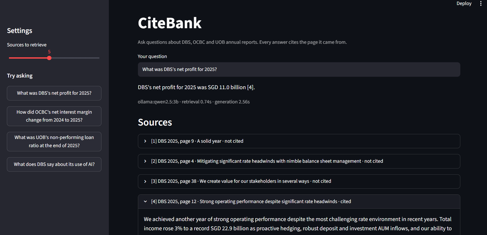
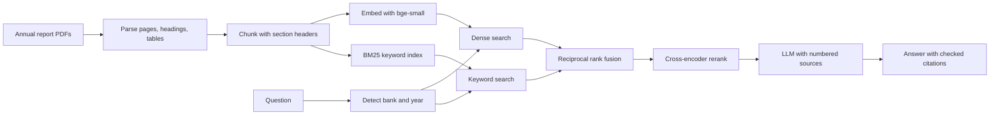

# CiteBank

Ask questions about the DBS, OCBC and UOB annual reports and get short answers that cite the exact page they came from. If the reports don't contain the answer, it says so instead of guessing.

The main part of this project is the evaluation suite. Every design choice (chunking, search method, reranking, local vs hosted LLM) is measured against a hand-checked question set, so I can show which choices actually improved results and by how much.



## What it does

- Parses long annual report PDFs, keeping page numbers, section headings and financial tables (tables are converted to markdown so figures stay in their rows and columns)
- Searches with dense vectors, BM25 keywords, or a hybrid of both, with an optional cross-encoder reranker
- Detects bank names and years in a question and only searches those reports
- Answers with a local model on my GPU (Ollama) or a hosted API (OpenAI or Anthropic), switchable with one setting
- Checks every citation the model writes against the sources it was actually given, and flags made-up ones
- Serves everything through a FastAPI service, with a Streamlit demo on top

## How it works



## Design decisions

**Layout-aware chunking.** Annual reports put most figures in tables, and a fixed-size word window cuts tables in half and mixes them with unrelated text. The `structured` strategy keeps each table whole (large ones are split by rows with the header row repeated), groups paragraphs under their heading, and never lets a chunk cross a page, so citations always point to one page. The `fixed` strategy is kept as a baseline to measure against.

**Section headers on every chunk.** Each chunk starts with a line like `[DBS annual report 2025 | page 48 | Section: Capital Management]`. A table of numbers on its own often doesn't say which bank or year it belongs to, and this line gives both the embedding and the keyword search that context.

**Hybrid search.** Vector search is good at paraphrases ("how much did the bank earn" vs "net profit"), and BM25 is good at exact terms like "CET1" or a specific year. I merge the two ranked lists with reciprocal rank fusion, which works on rank positions, because BM25 scores and cosine similarities aren't on the same scale.

**Banking acronym expansion.** Reports often write "Common Equity Tier 1" where a user would type "CET1". Keyword search can't connect the two on its own, so common acronyms (CET1, NIM, ROE, NPL and others) are expanded before searching.

**Bank and year filtering.** With six similar reports in the index, "DBS net profit 2025" can easily retrieve OCBC's 2024 profit table. When a question names a bank or year, the search is limited to those reports. If the filter would remove everything (for example a year that isn't indexed), it falls back to searching all reports.

**Reranking.** A cross-encoder reads the question and each candidate chunk together, which is more accurate than comparing vectors but slower. I retrieve 30 candidates cheaply and let the reranker choose the final 5. The eval measures what this costs in latency.

**Refusals and citation checks.** The prompt requires a citation after every factual sentence and an exact refusal phrase when the sources don't cover the question. After generation, every `[n]` is checked against the sources the model was given. The eval set includes questions the reports can't answer, to measure whether the system refuses instead of making something up.

**Two-page spreads.** Some reports (DBS) put two printed pages side by side on one wide PDF page. When a page is more than 1.2 times as wide as it is tall, the parser reads the left and right halves separately, because PyMuPDF can otherwise merge lines from both halves into one block when they sit at the same height. Within each half I keep PyMuPDF's own block order instead of sorting blocks top to bottom, since that order follows multi-column layouts and sorting by height would interleave the columns. Each table is then placed just before the first text block below it in the same column, so headings stay ahead of their tables. Both halves keep the same PDF page number, so a citation points to the spread.

**Local and hosted LLMs behind one interface.** Ollama runs `qwen2.5:3b` on my 6 GB laptop GPU for free; `qwen2.5:7b` is the option for GPUs with 8 GB or more. A hosted API gives better answers at a small cost per question. Both sit behind the same `generate()` method, so the eval can compare them on identical retrieval.

## Evaluation

The question set (`eval/questions.jsonl`) mixes four types:

| Type | Example | What it tests |
|---|---|---|
| numeric | What was DBS's CET1 ratio at the end of 2025? | Finding one figure, often inside a table |
| factual | How does OCBC describe its approach to managing credit risk? | Finding and summarising narrative text |
| comparison | How did OCBC's net profit change from 2024 to 2025? | Combining evidence from more than one place |
| unanswerable | What will DBS's share price be next year? | Refusing instead of guessing |

Each answerable question records the bank, year and page where the answer is, checked by hand against the PDF.

**Retrieval metrics**
- Hit@k: share of questions where at least one correct page is in the top k results
- MRR: how high the first correct page ranks (1.0 means always first)
- Recall@k: share of all evidence pages found, which matters for comparison questions

**Answer metrics**
- Correct refusals: unanswerable questions the system refused
- False refusals: answerable questions it wrongly refused
- Number match: share of the figures in the reference answer that appear in the generated answer
- Citation valid: no citations to sources that don't exist
- Cites right page: the answer cites at least one correct evidence page
- Faithful and Correct (optional): graded by an LLM judge, with its reasoning saved per question so I can spot-check it

**Experiments** (`eval/experiments.yaml`) change one thing at a time: BM25 baseline, dense search, structured chunking, hybrid search, reranking, bank/year filtering switched off, and finally the hosted LLM instead of the local one.

### Results

21 hand-checked questions (15 answerable, 6 unanswerable) over the six FY2024 and FY2025 reports, top 5 sources, answers from `qwen2.5:3b` running locally in Ollama on an RTX 4050 laptop GPU (6 GB). The hosted API experiment is not included yet. With 15 answerable questions each question is worth about 7 percentage points, so a one-question difference between experiments is within noise. The full report, including the retrieval misses, is in [`eval/results/sample_report.md`](eval/results/sample_report.md).

**Retrieval**

| Experiment | Chunking | Search | Rerank | Auto filter | Hit@k | MRR | Recall@k | Avg retrieval (ms) |
|---|---|---|---|---|---|---|---|---|
| bm25_fixed | fixed | bm25 | no | yes | 87% | 0.69 | 68% | 9 |
| dense_fixed | fixed | dense | no | yes | 80% | 0.54 | 49% | 39 |
| dense_structured | structured | dense | no | yes | 87% | 0.60 | 56% | 22 |
| hybrid_structured | structured | hybrid | no | yes | 87% | 0.62 | 62% | 29 |
| hybrid_rerank | structured | hybrid | yes | yes | 93% | 0.72 | 68% | 501 |
| hybrid_rerank_nofilter | structured | hybrid | yes | no | 93% | 0.65 | 66% | 487 |

**Answers**

| Experiment | LLM | Correct refusals | False refusals | Number match | Citation valid | Cites right page | Avg generation (s) |
|---|---|---|---|---|---|---|---|
| bm25_fixed | ollama: qwen2.5:3b | 100% | 13% | 58% | 100% | 73% | 0.86 |
| dense_fixed | ollama: qwen2.5:3b | 100% | 20% | 50% | 100% | 47% | 1.15 |
| dense_structured | ollama: qwen2.5:3b | 100% | 27% | 46% | 100% | 47% | 0.89 |
| hybrid_structured | ollama: qwen2.5:3b | 83% | 13% | 55% | 100% | 60% | 0.87 |
| hybrid_rerank | ollama: qwen2.5:3b | 83% | 13% | 68% | 100% | 73% | 0.90 |
| hybrid_rerank_nofilter | ollama: qwen2.5:3b | 83% | 7% | 67% | 100% | 67% | 0.72 |

The reranker made the biggest difference: hybrid search with reranking had the best retrieval (93% Hit@5, 0.72 MRR) and the best number match (68%), for about half a second of extra retrieval time per question, and switching off bank and year filtering cost it 0.07 MRR. Plain BM25 was a surprisingly strong baseline, tying on citing the right page (73%) and refusing all six unanswerable questions, while dense search alone was the weakest at finding the exact page. Most remaining failures come from the small local model rather than retrieval: it refused the OCBC net interest margin question even though the right page was retrieved and recommended a credit card it should have refused, and the one cross-bank comparison question never retrieved a DBS page (see Limitations).

## Setup (Windows)

You need Python 3.11 or newer, an NVIDIA GPU with current drivers (optional, but embedding is much faster with it), and [Ollama](https://ollama.com) for the local LLM.

```powershell
git clone https://github.com/Lagatorase/citebank
cd citebank
python -m venv .venv
.venv\Scripts\activate

# install torch with CUDA first: pick the command for your CUDA version at https://pytorch.org/get-started/locally/
pip install torch --index-url https://download.pytorch.org/whl/cu124
pip install -r requirements.txt

copy .env.example .env
ollama pull qwen2.5:7b
```

Check that torch can see the GPU with `python -c "import torch; print(torch.cuda.is_available())"`.

If your GPU has less than 8 GB of memory, use the smaller model instead: run `ollama pull qwen2.5:3b` and set `OLLAMA_MODEL=qwen2.5:3b` in `.env`. The 7B model won't fit on the GPU next to the embedding model and reranker, so part of it runs on the CPU and answers are much slower. The results above were produced with `qwen2.5:3b` on a 6 GB laptop GPU.

### Add the reports

Download the FY2024 and FY2025 annual reports from each bank's investor relations website and save them in `data/raw` with the bank and year in the file name:

```
data/raw/dbs_2024.pdf    data/raw/ocbc_2024.pdf    data/raw/uob_2024.pdf
data/raw/dbs_2025.pdf    data/raw/ocbc_2025.pdf    data/raw/uob_2025.pdf
```

The PDFs are not committed to this repo (they're in `.gitignore`), since the reports belong to the banks.

To try the pipeline before downloading anything, generate two small fictional "Demo Bank" reports instead:

```powershell
python scripts/make_sample_report.py
```

Delete `data/raw/demo_*.pdf` once the real reports are in.

### Build and ask

```powershell
python -m citebank.cli build
python -m citebank.cli ask "What was DBS's net profit for 2025?"
python -m citebank.cli search "OCBC CET1 ratio 2025"        # retrieval only, no LLM call
python -m citebank.cli ask "What was UOB's NPL ratio in 2025?" --llm anthropic
```

The first build downloads the embedding model and parses every page, so it takes a few minutes for six reports. Later runs load the saved index.

### API and demo

```powershell
uvicorn api.main:app --reload            # API docs at http://localhost:8000/docs
streamlit run app/streamlit_app.py       # demo at http://localhost:8501
```

Or run both with Docker (build the index on the host first, since the container mounts `data/`):

```powershell
docker compose up --build
```

## Running the evaluation

1. Open `eval/questions.jsonl`. For each answerable question, find the answer in the PDF, fill in `answer` and `evidence` (bank, year and the page number shown in your PDF viewer), and set `"verified": true`. The unanswerable questions are already complete.
2. Optionally draft more questions with an LLM, then check them the same way before moving them into `questions.jsonl`:
   ```powershell
   python -m eval.generate_questions --n 30 --llm anthropic
   ```
3. Run the experiments:
   ```powershell
   python -m eval.run_eval --retrieval-only          # fast, retrieval metrics only
   python -m eval.run_eval                           # full run with answers
   python -m eval.run_eval --judge anthropic         # add LLM-judge grading
   ```

To check the whole eval pipeline offline with the demo reports and no model downloads:

```powershell
python -m eval.run_eval --questions eval/demo_questions.jsonl --config eval/demo_experiments.yaml
```

## Tests

```powershell
pytest
```

The tests build the fictional demo reports and use a hashing embedder and a stub LLM, so they run offline in a few seconds. They cover PDF parsing (tables, headings, header and footer removal), both chunking strategies, search and filtering, citation checking, the eval metrics, and the request and response handling of every backend.

## Project structure

```
citebank/
  config.py        settings from .env
  ingest.py        PDF parsing: pages, headings, tables, header/footer removal
  chunking.py      fixed and structured chunking
  embeddings.py    local (sentence-transformers), OpenAI, and hashing embedders
  store.py         on-disk vector index and BM25
  retrieval.py     dense, BM25 and hybrid search, filters, reranker
  llm.py           Ollama, OpenAI and Anthropic backends
  prompts.py       system prompt and source formatting
  pipeline.py      retrieve, generate, check citations
  cli.py           command line
api/main.py        FastAPI service
app/streamlit_app.py  demo UI
eval/              question sets, metrics, experiment runner, question generator
scripts/           fictional demo report generator
tests/
```

## Limitations and next steps

- Comparison questions across all three banks need evidence from three reports, but top-5 retrieval can fill up with one bank. Splitting the question into one sub-question per bank before searching would fix this.
- Charts and infographics are images, so figures that only appear in a chart are invisible to the parser.
- Page numbers are PDF page numbers, which can differ from the numbers printed on the report pages.
- The LLM judge is itself a model and can be wrong, which is why its reasoning is saved for every question.
- The index is a NumPy array searched by brute force. That is fast enough for six reports, but a vector database like pgvector or Qdrant would be needed for thousands of documents.
